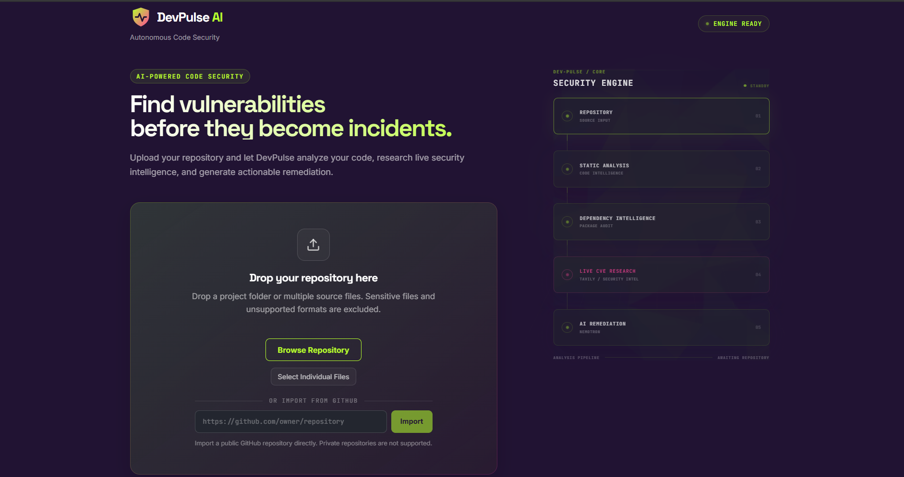
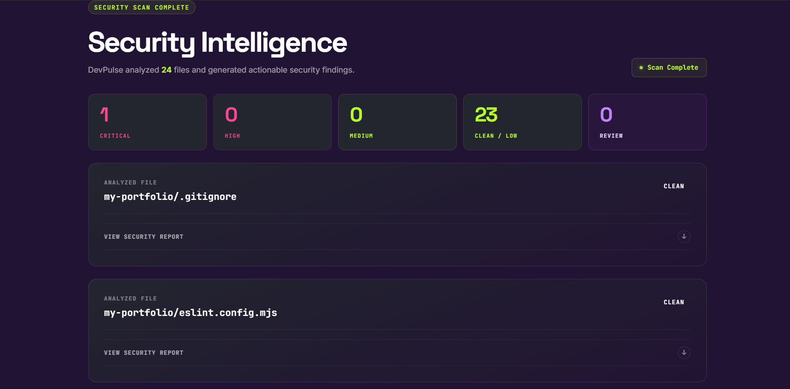

# DevPulse AI
### Autonomous Code Security & Live Vulnerability Researcher

**Find vulnerabilities before they become incidents.**

DevPulse AI is an AI-powered code security analysis platform that helps developers identify potential vulnerabilities, detect risky coding patterns, audit dependencies, research live security intelligence, and generate actionable remediation guidance.

By combining custom static security analysis, dependency auditing, Tavily-powered security research, and NVIDIA Nemotron through Nebius Token Factory, DevPulse AI brings multiple security intelligence capabilities into one unified developer-focused workflow.

**[Live Demo](https://devpulse-ai-iz95.onrender.com) · [GitHub Repository](https://github.com/ArpitVentures/DevPulse-AI)**

---

## Project Preview



*DevPulse AI — AI-powered security analysis interface with repository upload and GitHub import.*

---

## Security Intelligence Dashboard

The Security Intelligence dashboard provides a consolidated view of repository scan results, including vulnerability severity distribution, analyzed files, and security findings.



*Security scan overview highlighting vulnerability severity classifications and file-level analysis results.*

---

## Key Features

- **Static Security Analysis** — Scan source files for potentially dangerous coding patterns and security issues using custom static security detectors.
- **GitHub Repository Import** — Import public GitHub repositories directly through their repository URL without manually downloading source code.
- **Local Repository Upload** — Upload complete project folders or select multiple individual source files for analysis.
- **Dependency Auditing** — Analyze supported dependency information to identify known security risks.
- **Live Vulnerability Research** — Use Tavily Search API to retrieve relevant security intelligence and supporting sources.
- **AI-Powered Explanations** — Leverage NVIDIA Nemotron to generate contextual security explanations and remediation recommendations.
- **Security Intelligence Dashboard** — Explore file-level reports, severity classifications, findings, and recommended actions.
- **Resilient Analysis** — Handle AI and live research failures without automatically interrupting core static analysis.

---

## How It Works

DevPulse AI follows a multi-stage security analysis pipeline:

1. **Repository Input** — Upload a local project, select individual files, or provide a public GitHub repository URL.
2. **Repository Processing** — Collect supported source files while excluding sensitive and unsupported content.
3. **Static Analysis** — Inspect source code for potentially dangerous coding patterns.
4. **Dependency Intelligence** — Audit supported package information for known security risks.
5. **Live Security Research** — Retrieve relevant vulnerability intelligence through Tavily.
6. **AI-Powered Explanation** — Use NVIDIA Nemotron to explain findings and suggest possible remediation strategies.
7. **Security Reporting** — Present analysis results through file-level security reports and the dashboard.

---

## Technology Stack

| Component | Technology |
|---|---|
| Frontend | React, TypeScript, Vite |
| Backend | Node.js, Express.js, TypeScript |
| Static Analysis | Custom Security Detectors |
| Dependency Analysis | Custom Dependency Auditing |
| AI Model | NVIDIA Nemotron |
| AI Infrastructure | Nebius Token Factory |
| Security Research | Tavily Search API |
| Version Control | Git, GitHub |
| Deployment | Render |
| Testing | Automated Detector and Service Tests |

---

## Installation & Setup

### Prerequisites

- Node.js and npm
- Nebius Token Factory API key
- Tavily API key

### Clone the Repository

Clone the project and navigate to its directory:

```bash
git clone https://github.com/ArpitVentures/DevPulse-AI.git
cd DevPulse-AI
```

### Install Dependencies

```bash
npm install
```

### Environment Configuration

Create a `.env` file in the project root and configure your API credentials:

```env
NEBIUS_API_KEY=your_nebius_api_key
TAVILY_API_KEY=your_tavily_api_key
```

Never commit your `.env` file or expose API credentials in a public repository.

### Run Locally

Start the frontend and backend using the development scripts configured in `package.json`.

---

## Testing

The project includes automated tests covering:

- Static security detectors.
- Dependency auditing.
- Relevant analysis services.

Run the test script configured in `package.json` to execute the available tests.

---

## Security & Limitations

DevPulse AI is a security analysis aid, not a replacement for comprehensive security audits, penetration testing, or manual code review.

- Static detection may produce false positives or miss vulnerabilities.
- Dependency audit coverage depends on available package metadata and vulnerability information.
- AI-generated explanations and remediation suggestions should be independently verified.
- Live research depends on API availability, network connectivity, and provider limits.
- GitHub import currently supports public repositories only.
- Repository analysis is subject to file-count and content-size limits.
- Sensitive files and unsupported formats are excluded from processing.

---

## Project Goal

The goal of DevPulse AI is to make code security analysis more accessible by combining automated detection, dependency intelligence, live vulnerability research, and AI-assisted explanations into a unified developer-focused workflow.

DevPulse AI aims not only to identify potentially risky code, but also to help developers understand security concerns and investigate actionable remediation strategies.

---

## Author

**Arpit Srivastava**

- GitHub: [@ArpitVentures](https://github.com/ArpitVentures)
- Project: [DevPulse AI](https://github.com/ArpitVentures/DevPulse-AI)

---

## License

This project is licensed under the MIT License. See the [LICENSE](LICENSE) file for details.

---

<p align="center">
  **Built for the Nebius × NVIDIA Global AI Hackathon.**
</p>